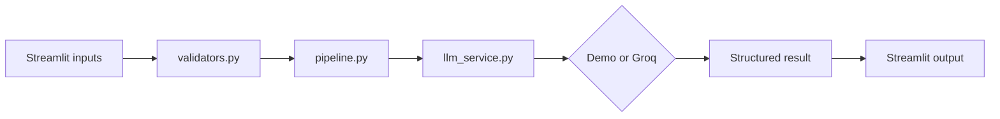

# StartupSpark AI — Startup Pitch and Business Idea Generator

StartupSpark AI helps student innovators and entrepreneurship clubs turn a rough idea into a structured concept brief, first pitch, and customer-validation plan.

## Problem and objectives

Early-stage founders often have an idea but lack a clear problem statement, audience, value proposition, and learning plan. StartupSpark organizes those inputs and makes uncertainty visible. Its objectives are to:

- collect five concrete startup inputs;
- produce a concise planning brief;
- distinguish user-provided information from assumptions and unverified claims; and
- suggest practical customer-validation actions.

## Features

### MVP

- Required inputs: problem or idea, target customer, geography, constraints, and existing alternatives.
- Input validation for empty and oversized fields.
- Structured concept brief, value proposition, MVP features, risks, interview questions, pitch outline, and validation checklist.
- Demo mode that works without an API key and is explicitly labeled as demo output.
- Optional Groq provider with timeout and readable provider failures.
- Reset, loading, and error states.

### Advanced extensions

- Alternative comparison: turns only the user-entered alternatives into verification questions; it does not assert competitor facts.
- Unit economics worksheet: calculates transparent arithmetic from editable assumptions using pandas; currency and market inputs are not assumed.
- Two-week experiment plan: provides five evidence-oriented periods and a decision step; it does not claim a success threshold or validation.

## Technology stack

- Python 3.11 or 3.12 recommended. Local development was inspected with Python 3.14.7.
- Streamlit 1.50.0
- pandas 2.3.3 for the editable unit-economics worksheet
- Optional Groq SDK 0.33.0
- python-dotenv 1.1.1
- pytest 8.4.2
- No database, uploads, or persistent storage.

## Architecture



`app.py` collects inputs and renders states. `backend/utils/validators.py` owns input validation. `backend/core/pipeline.py` owns the StartupSpark prompt and output schema. `backend/services/llm_service.py` owns provider calls and the deterministic demo fallback. `backend/config.py` reads secrets from Streamlit secrets first and environment variables second.

## Project structure

- `app.py`: Streamlit UI and end-to-end orchestration.
- `backend/config.py`: provider settings and secret access.
- `backend/core/pipeline.py`: prompt construction and result parsing.
- `backend/services/llm_service.py`: Groq adapter, timeout, errors, and demo mode.
- `backend/utils/validators.py`: input contract and limits.
- `backend/core/extensions.py`: alternative comparison, unit economics, and experiment planning.
- `tests/`: validation and pipeline tests.
- `.streamlit/config.toml`: safe theme configuration.
- `.env.example`: placeholder configuration only.

## Prerequisites and installation

Use Python 3.11 or 3.12 for the documented environment, plus Git. From the repository root:

```bash
python3.12 -m venv .venv
source .venv/bin/activate
python -m pip install --upgrade pip
pip install -r requirements.txt
cp .env.example .env
```

On Windows PowerShell, use `py -3.12 -m venv .venv`, `.venv\\Scripts\\Activate.ps1`, and `copy .env.example .env`.

## Configuration

Demo mode is the default and needs no secret. For a live provider, set these names in local `.env` or Streamlit Community Cloud Secrets:

```toml
LLM_PROVIDER="groq"
GROQ_API_KEY="your-own-key"
MODEL_NAME="openai/gpt-oss-20b"
```

Never commit `.env` or `.streamlit/secrets.toml`. Do not put personal, confidential, or private data into the app.

## Run

```bash
streamlit run app.py
```

The default local address is `http://localhost:8501`. In demo mode, enter for example:

- Problem: Students struggle to find affordable meals between classes.
- Target customer: University students living off campus.
- Geography: One university campus in Bengaluru.
- Constraints: Two founders, low budget, no delivery fleet.
- Existing alternatives: Canteen, food delivery apps, cooking at home.

The output is a planning aid, not evidence that the idea is validated.

## Testing

Run:

```bash
pytest -q
```

The automated suite covers valid input, empty input, oversized input, all-missing input, unknown fields, prompt grounding, demo generation, required sections, unsupported providers, malformed provider output, unverified-claim labeling, alternative comparisons, unit-economics arithmetic, non-positive contribution margins, the two-week plan, home rendering, form validation, and valid UI submission. Manual checks still needed before submission include resetting the form, testing a real provider failure without exposing a key, and capturing final submission screenshots.

### Test report

| # | Scenario | Expected result | Actual/result |
|---|---|---|---|
| 1 | Five valid fields | Accepted | Automated test; pass |
| 2 | Empty problem | Helpful validation error | Automated test; pass |
| 3 | Oversized constraints | Length error | Automated test; pass |
| 4 | All required fields missing | Five useful errors | Automated test; pass |
| 5 | Unknown extra field | Ignored without replacing required inputs | Automated test; pass |
| 6 | Prompt with inputs | Inputs and guardrail appear | Automated test; pass |
| 7 | Demo generation | Structured result returned | Automated test; pass |
| 8 | Missing sections from provider | Readable provider error | Automated test; pass |
| 9 | Malformed provider response | Readable provider error | Automated test; pass |
| 10 | Unsupported provider | Readable provider error | Automated test; pass |
| 11 | Missing API key | Demo mode is clearly labeled | Manual UI check required |
| 12 | Provider/API failure | Readable error, no crash | Manual live-provider check required |
| 13 | Competitor/market claim | Marked unverified | Automated test; pass |
| 14 | Reset action | Clears output and fields | Manual UI check required |
| 15 | Alternative comparison | User alternatives become verification questions | Automated test; pass |
| 16 | Unit economics | Editable assumptions produce arithmetic | Automated test; pass |
| 17 | Non-positive margin | Break-even is not falsely calculated | Automated test; pass |
| 18 | Two-week experiment | Five evidence-oriented periods appear | Automated test; pass |
| 19 | Home page render | Required controls appear | Automated test; pass |
| 20 | UI empty submission | Five validation messages appear | Automated test; pass |
| 21 | UI valid submission | Brief and extensions render | Automated test; pass |

Observed automated result on 2026-10-25: `18 passed in 0.85s` using Python 3.14.7 in the project virtual environment. A browser smoke check also reached the home page, displayed the empty-input errors, and generated a demo brief with advanced-extension tabs. Live-provider checks remain separate from the automated suite.

## Deployment

The app is prepared for Streamlit Community Cloud: root `app.py`, pinned requirements, and secrets instructions are present. A public repository URL and deployed URL have not been created in this workspace. Deployment still requires pushing to GitHub, selecting `app.py`, and adding the TOML secrets through the platform settings if live Groq mode is desired.

## Known limitations and responsible use

The demo output is template-based and does not perform research. Groq output can be incomplete or wrong. No market size, competitor performance, cost, revenue, or financial projection is verified by this app. Unit economics are arithmetic over assumptions, not forecasts. There is no authentication, database, history, upload, or persistence. Rate limits and model availability depend on the provider. Use synthetic or public information only and verify important claims through real customer research.

## Submission gaps

Screenshots, a live Streamlit URL, and a GitHub URL require external accounts or manual capture. A project report and presentation outline are included in `docs/`; screenshots should be captured after running the local app with the synthetic sample input.

## Credits and license

Uses Streamlit, python-dotenv, pytest, and the optional Groq Python SDK. No external dataset is included. No license has been selected for this student project.
